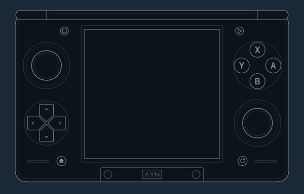
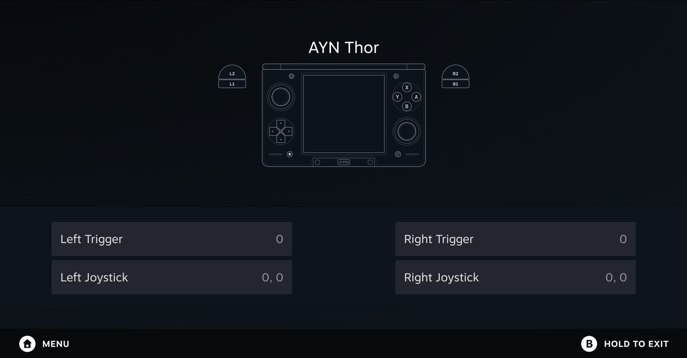
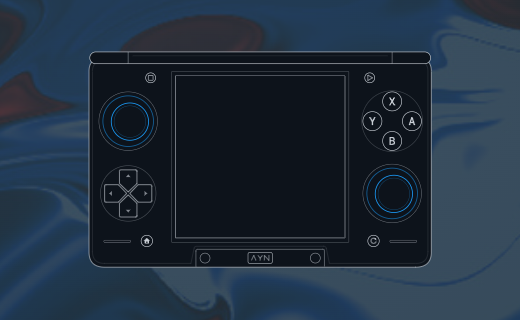
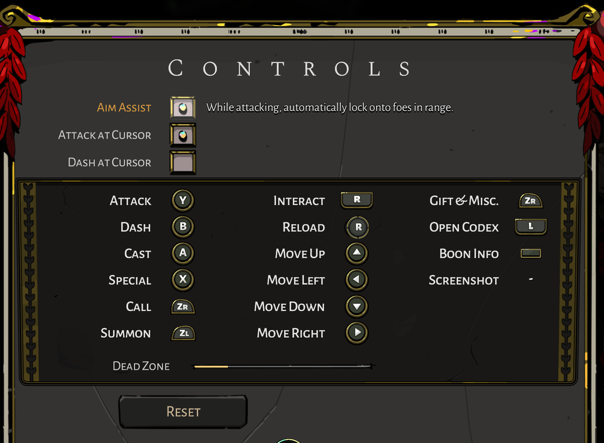

# AYN Thor on SteamOS

Everything I built and learned running SteamOS on my AYN Thor (the ARM SteamOS image from [pb-os](https://github.com/project-barry/pb-os)), shared to help anyone doing the same. Right now it covers two things: making the Thor's built-in controller feel native in Steam, which is the most complete part, and the kernel I build for it.

You'll find the files themselves (artwork, plugin source, InputPlumber and kernel patches, tools), the docs on how each piece works and what I proved, and the dead ends I hit along the way. It's all still a work in progress, and the code is written for my own Thor, so nothing installs itself. [Using these files on your own Thor](docs/use-it.md) says what I did with each piece. If you're handing this to an AI assistant, point it at [AGENTS.md](AGENTS.md) first.

## Credits

I didn't build the platform this runs on. These projects did the hard parts, and none of this works without them:

- [pb-os](https://github.com/project-barry/pb-os) by Project Barry, the SteamOS image for the Thor and other SM8550 handhelds, plus its Thor controller config. It builds on [SteamOS-ARM-Port](https://github.com/hashtagbasit/SteamOS-ARM-Port) and [SteamOS-ARM-SM8550](https://github.com/MaSieS4Fun/SteamOS-ARM-SM8550).
- [InputPlumber](https://github.com/ShadowBlip/InputPlumber) by ShadowBlip. It turns the Thor's controller into the virtual pads Steam sees. My Switch Pro work is a set of patches to it.
- [Decky Loader](https://github.com/SteamDeckHomebrew/decky-loader), which runs my two Steam plugins.
- [Handheld Controller Glyphs](https://github.com/victor-borges/handheld-controller-glyphs) by victor-borges. I copied its method of swapping Steam's button icons and controller pictures.
- [nxbt](https://github.com/Brikwerk/nxbt), [joycontrol](https://github.com/Poohl/joycontrol), SDL's Switch driver and the Linux `hid-nintendo` driver, which taught me the Switch Pro Controller protocol.
- [PCGamingWiki](https://www.pcgamingwiki.com/), whose controller tables tell my setup which games ship Nintendo button icons.
- [hexagonrpc](https://github.com/linux-msm/hexagonrpc), pb-os's sensor patches and the SteamOS-ARM gyro research, for reading the motion sensor.
- For the kernel: pb-os's kernel recipe, [ROCKNIX](https://github.com/ROCKNIX/distribution), and five patches from [Armada OS](https://github.com/armada-os/armada), taken unchanged.

Every project, its license, what I took and what I changed: [CREDITS.md](CREDITS.md).

## The controller: what I wanted

1. The Thor's buttons are printed like a Nintendo pad (A on the right, B on the bottom). In Steam's own menus, the A on the right should confirm.
2. Games that ship Nintendo button icons should show them. Every other game should work like an Xbox pad, where the bottom button is A.
3. Steam should draw a Thor, not a Switch Pro Controller or a Steam Deck, along with the icons that are actually printed on the Thor's buttons.

## The controller: what works on my Thor

Everything in this table was checked on the device. "Separate review" means an AI agent that didn't write the code compared screenshots and logs against what the row claims. "Tested by hand" means I pressed the buttons myself.

| Thing | Status | How it was checked |
|---|---|---|
| Steam sees the Thor as a **Nintendo Switch Pro Controller** (my [InputPlumber patches](reference/inputplumber/)) | Works | The kernel's `hid-nintendo` driver binds the virtual pad, which streams about 221 full input reports a second. Steam lists it as a Switch Pro with the Nintendo layout. In Steam's menus I tested A (right) to confirm, B to go back, Home to open the Steam menu and Quick Access to open Quick Access, all by hand. |
| **Default identity:** the analog handheld pad, named "AYN Thor" | Works, it's my everyday setup | Steam lists it as the SteamOS handheld type with the name "AYN Thor", and its trigger readout moves through the in-between values. |
| **Nintendo mode per game:** a game that PCGamingWiki says ships Nintendo icons gets the Switch Pro identity, Steam Input off and the Nintendo layout, automatically | Works | A plain launch of Hades drew its Switch icons (Y, B, A, X, ZL, ZR). The printed A selected and the printed B went back. Confirmed by a separate review of the screenshots and FatterPad's decision log. |
| **Xbox layout for every other game** (the bottom button is A) | Works | Balatro drew Xbox icons, and the bottom button (printed B) selected. I tested Balatro and Mario Kart 8 (in the Eden Duo emulator) by hand. Hades and a RetroArch game were checked with logs and screenshots, and I signed off on all four. |
| A per-game layout flip from Quick Access that's remembered, and wins over the automatic choice | Works | Separate review of a flipped game's saved choice |
| My own list of every Steam game I own, with PCGamingWiki's Nintendo-icons answer, which picks up new games | Works | `prompts-db status` reports no owned game left to look up |
| **The Thor drawn in Steam's controller screens** (controller settings, Test Device Inputs, the layout editor, the Quick Access controller panel) | Works, and survives a Steam restart | Separate review of screenshots of each screen |
| A live Thor on Test Device Inputs: buttons, D-pad, sticks and an analog trigger fill all light up | Works | Tested by hand: "this screen looks great now. All of the buttons work properly. They light properly. The triggers work properly." |
| The **icons printed on the Thor's system buttons** in Steam's menus (a house for Home, a triangle for Start, a square for Select) | Works on both identities | Separate review of screenshots against the printed-icon list |
| The **animated Thor on the game-launch screen** | Works | Separate review of a screenshot taken during a launch |
| **Gyro in the 3DS emulator** (Azahar on SteamOS, fed over DSU) | Works, on my patched kernel | The gyro moves the view in Ocarina of Time 3D. Drift filtering was added after I saw the view creep in my hands. The sensor streams at about 218 samples a second, and lies flat at about 1 g. |
| **Gyro through Steam Input** | Not yet | Steam's test screen shows no gyro on the default identity. Details and limits in [gyro.md](docs/gyro.md). |

Not done, or not checked yet:

- Button icons inside games that ask Steam for icon images. Those games read image files that my runtime CSS can't reach, so they still get Steam's standard icons.
- The Thor drawing on Steam's Calibration screen. It's in the code, but I haven't put it through the same screenshot check.
- Gyro through Steam Input, and gyro in Eden and Dolphin. The feed is pointed at both, but I've only confirmed it in Azahar.
- The motion daemon streams all the time and costs about 3.5% of a core on average ([gyro.md](docs/gyro.md)). Streaming only while something listens is planned, not built.
- Any Thor other than mine (16 GB), and any Steam client newer than the one listed below.

Steam's Test Device Inputs on my Thor, with the Thor drawing in place of Steam's:

The animated Thor on Steam's game-launch screen, and Hades drawing its own Switch icons in Nintendo mode:

## The kernel

I build pb-os's own kernel recipe myself, with a few patches on top: some mine, some from other projects. That covers what pb-os's prebuilt kernel didn't have yet when I needed it, including the kernel half of the gyro. Each patch, where it came from, what it fixed and how I checked it: [docs/kernel.md](docs/kernel.md). The patches and build scripts are in [reference/kernel/](reference/kernel/).

## The pages

Start here: [Using these files on your own Thor](docs/use-it.md).

Controller:

1. [The Thor's buttons, and what SteamOS sees](docs/buttons.md)
2. [How games pick their button icons](docs/how-games-pick-icons.md)
3. [The Switch Pro identity (InputPlumber patches)](docs/switch-pro-identity.md)
4. [Per-game layouts and Nintendo mode (FatterPad)](docs/per-game-layout.md)
5. [Drawing the Thor in Steam (ThorLook)](docs/thorlook.md)
6. [Gyro on SteamOS: sensor to emulator](docs/gyro.md)
7. [Gotchas](docs/gotchas.md)

Kernel:

8. [My Thor kernel: what's in it and where it came from](docs/kernel.md)

## What's in this repo

| Folder | What |
|---|---|
| [art/](art/) | The Thor drawings (plain, animated and open clamshell), the button icons, PNG previews, and the scripts that made them. |
| [docs/](docs/) | The research, one page per topic. |
| [reference/](reference/) | The files themselves. The controller code that runs on my Thor, which I checked byte-for-byte against the device on 29 October 2026 (apart from comments cleaned up for publishing). The InputPlumber patches. My kernel patches, config and build and swap tools. Paths, user names and service setup are mine, so adapt them rather than running them as-is. |

## My setup

- AYN Thor, 16 GB
- SteamOS from a pb-os base (alpha v0.5.2, with later pb-os fixes taken one at a time), SteamOS build 20260922.6101926
- My own kernel build, `7.2.8-sm8550-ff6` ([kernel.md](docs/kernel.md))
- Steam client 1790121765, in Game Mode
- InputPlumber 0.81.0 with pb-os's two haptics patches and my five patches
- Decky Loader

## How this was made

I built this with AI. Claude Code (Anthropic's Claude) wrote the code and the docs and ran the tests on the Thor over SSH. I decided what to build, tested it by hand and approved every step. The drawings were made by an OpenAI Codex agent from AYN's official product renders and review photos, matched to the style of Valve's own controller art. Before anything went into the "works" table, it was checked as described there.

## License

- My art and docs: [CC BY 4.0](LICENSES/CC-BY-4.0.txt). Use them however you like, with credit.
- My code: [MIT](LICENSES/MIT.txt).
- The InputPlumber patches: [GPL-3.0](LICENSES/GPL-3.0.txt), because they change a GPL-3.0 project.
- The Decky API connection code inside the plugin front ends comes from [@decky/api](https://github.com/SteamDeckHomebrew/loader-api), [LGPL-2.1](LICENSES/LGPL-2.1.txt).

Details per file: [LICENSE](LICENSE). AYN and Thor are AYN's trademarks. Steam and SteamOS are Valve's. Nintendo Switch is Nintendo's. This project isn't affiliated with any of them.
