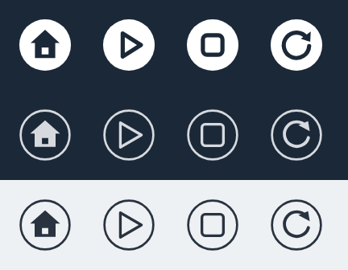
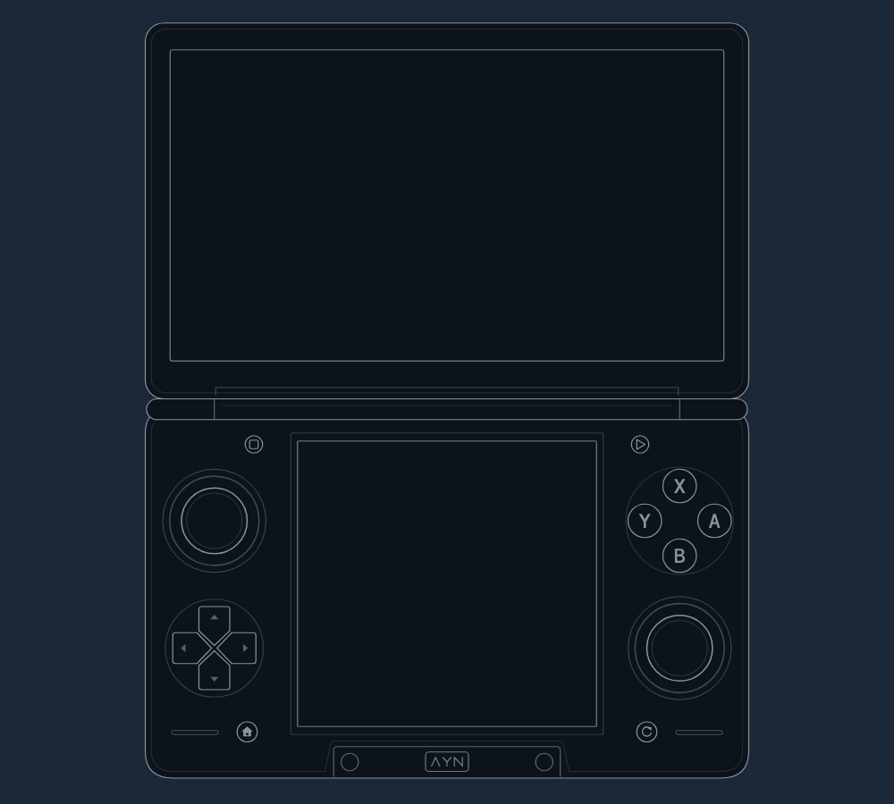

# Thor artwork

Vector drawings of the AYN Thor's controls and its button icons, made to sit next to Steam's own controller art. Licensed [CC BY 4.0](../LICENSES/CC-BY-4.0.txt): use them in your own projects, with credit.

| File | What |
|---|---|
| `thor_lower.svg` | The main drawing: the lower half (controls, bottom screen, hinge edge), 1000 x 640. |
| `thor_lower_animated.svg` | The same drawing plus a one-time 2.2-second intro. Its settled frame matches the static drawing exactly. |
| `thor_open.svg` | The open clamshell with the top screen, 1000 x 900. A spare: Steam doesn't use it. |
| `thor_cal_left.svg`, `thor_cal_right.svg` | Crops for Steam's Calibration screen, made from `thor_lower.svg` by `tools/make_calibration.py`. |
| `glyphs/glyph_{home,triangle,square,back_qam}_{steam,dark,light}.svg` | 64 x 64 button icons. `steam` is the filled style Steam's prompts use. `dark` is a light outline for dark backgrounds. `light` is a dark outline for light backgrounds. |
| `png/` | Previews rendered by `tools/render_previews.py` (headless Chrome, with each frame of the intro paused in place for the GIF). |
| `tools/make_calibration.py` | Rebuilds the two Calibration crops from `thor_lower.svg`. Run it after editing the drawing. |

## Ids for lighting controls

Every control is its own group with a stable id, so code can highlight it when it's pressed (ThorLook does this on Test Device Inputs): `lstick`, `lstick_ring`, `rstick`, `rstick_ring`, `dpad` (with `dpad_up`, `dpad_right`, `dpad_down`, `dpad_left`), `btn_a`, `btn_b`, `btn_x`, `btn_y`, `btn_home`, `btn_back_qam`, `btn_square`, `btn_triangle`, `screen_bottom`. Also `btn_front_left`, `btn_front_right`, `btn_ayn`, `front_tab`, `hinge`, `speakers` and `lower_body`. The open drawing adds `screen_top` and `lid`.

The stick caps sit inside their `lstick` / `rstick` groups, and the rings around them are separate groups, so moving a stick doesn't move its surround. A CSS `background-image` can't reach ids inside an SVG. To light controls, put the SVG inline.

## Style

Matched to Valve's Steam Deck controller art: body fill `#0D131B`, outlines and symbols `#8B929A`, seams the same grey at lower opacity. Main outlines are 1.6 units wide in the 1000-wide drawing. All lettering (A/B/X/Y and the small AYN mark) is drawn as paths, so no font is needed. No gradients, filters or raster images.

## The intro animation

Pure SMIL inside the SVG, so it also plays as a CSS background image:

- 0 to 2.2 s: the two stick rings fade up and settle.
- 0.18 to 1.58 s: each stick cap makes one small circle and returns to centre.
- A starts at 0.60 s, B at 0.79, Y at 0.98, X at 1.17. Each gets a short fill pulse.
- Everything is done by 2.2 s and runs once (`repeatCount="1"`).

## Where the button icons sit

| Position, looking down at the lower half | Printed icon | Group |
|---|---|---|
| Bottom-left, under the D-pad | House | `btn_home` |
| Bottom-right, under the right stick | Open circular arrow | `btn_back_qam` |
| Upper-left of the bottom screen, by the hinge | Small rounded square | `btn_square` |
| Upper-right of the bottom screen, by the hinge | Outlined triangle pointing right | `btn_triangle` |

The slits beside the two lower round buttons are speaker grilles. The two unlabelled circles beside the AYN plate on the front tab are drawn, but I don't know what they're mapped to, so the drawing doesn't say.

## How it was made

An OpenAI Codex agent drew it from AYN's official product renders and a SteamDeckHQ review photo, then checked it against a perspective-corrected photo of the lower half. The L1/L2 and R1/R2 shoulder markers on Test Device Inputs aren't in these files. They're drawn by ThorLook's code from a Tech Tactician photo of the top edge. It's an optical reconstruction, not AYN's CAD: radii and small details are close, not exact. The button placements are certain. None of the reference photos are in this repo.
