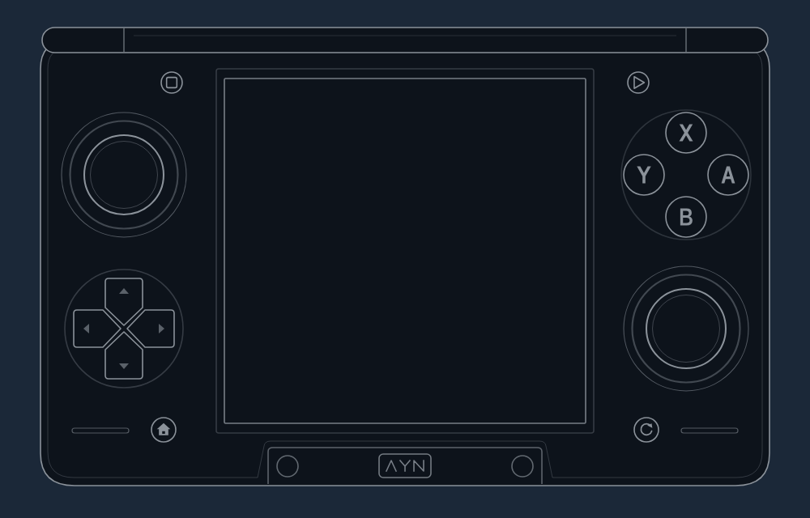

# The Thor's buttons, and what SteamOS sees

## What's printed on the device

The Thor's face buttons are printed like a Nintendo pad: **A on the right, B on the bottom, X on top, Y on the left**. An Xbox pad has A on the bottom and B on the right, so the letters and the positions disagree. Anything that maps "A" has to decide whether it means the letter or the position.

The four system buttons each carry a small printed icon instead of a name:

| Where (looking down at the lower half) | Printed icon | What it is | Id in my drawing |
|---|---|---|---|
| Bottom-left, under the D-pad | A house | Home | `btn_home` |
| Bottom-right, under the right stick | An open circular arrow | Back on Android, Quick Access on SteamOS | `btn_back_qam` |
| Upper-left of the bottom screen, by the hinge | A small rounded square | Select | `btn_square` |
| Upper-right of the bottom screen, by the hinge | An outlined triangle pointing right | Start | `btn_triangle` |

The long slits beside the two lower round buttons are speaker grilles, not buttons. The Thor has no back buttons (no L4, L5, R4 or R5). The shoulders are a thin L1/R1 bar with a rounded L2/R2 trigger stacked on it, and the triggers are analog.

## What SteamOS sees

On pb-os, the Thor's controller shows up to Linux as an evdev device named `AYN Odin2 Gamepad`. Steam never reads it directly. [InputPlumber](https://github.com/ShadowBlip/InputPlumber) grabs it and presents a virtual pad, the "target", to Steam. On a stock pb-os Thor that target is `deck-uhid` (USB id `28de:12f0`), the SteamOS handheld pad. It has analog triggers and a real Quick Access button, and Steam lists it as type 100, "SteamOS Handheld Controller". ThorLook renames it "AYN Thor" through Steam's own controller-name setting (see [thorlook.md](thorlook.md)).

InputPlumber's config for the Thor (`50-ayn_thor.yaml` in pb-os) uses a capability map that sends the four face buttons **by their printed letter**.

InputPlumber's button names come from Linux key codes, not positions:

| InputPlumber name | Linux code | Thor button (printed) |
|---|---|---|
| `South` | `BTN_SOUTH` / `BTN_A` | A (right) |
| `East` | `BTN_EAST` / `BTN_B` | B (bottom) |
| `North` | `BTN_NORTH` / `BTN_X` | X (top) |
| `West` | `BTN_WEST` / `BTN_Y` | Y (left) |

On the Thor, `South` is the right-hand button, not the bottom one. That's easy to get backwards. I did it once in my own Switch Pro target (the X/Y swap noted in [gotchas.md](gotchas.md)). Steam's handheld Test Device Inputs screen is a quick way to check: send `North` and see which button lights up.

## Check that only one Thor config loads

My Thor had three InputPlumber configs that matched it. Two were left behind in `/etc/inputplumber/devices.d/`, and one of those turned the pad into an Xbox Elite with a different A/B/X/Y swap. Which one won depended on boot timing. After I removed the extras, InputPlumber loads only `/usr/share/inputplumber/devices/50-ayn_thor.yaml` and makes one composite device with the `deck-uhid` target plus a keyboard. If your face buttons change between boots, look there first.

## The two layouts I use

| Name in my code | Meaning | Who gets it |
|---|---|---|
| `letters` (the Nintendo layout) | The printed A is A. InputPlumber's stock behaviour on the Thor. | Steam's own menus, games that ship Nintendo icons, my emulator launchers |
| `positions` (the Xbox layout) | The bottom button is A, so when a game says A, you press the bottom button (printed B). | Every other game. My default. |

`positions` swaps both pairs: South with East, and North with West. How a game ends up with one or the other is in [per-game-layout.md](per-game-layout.md).
