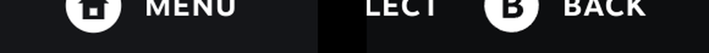
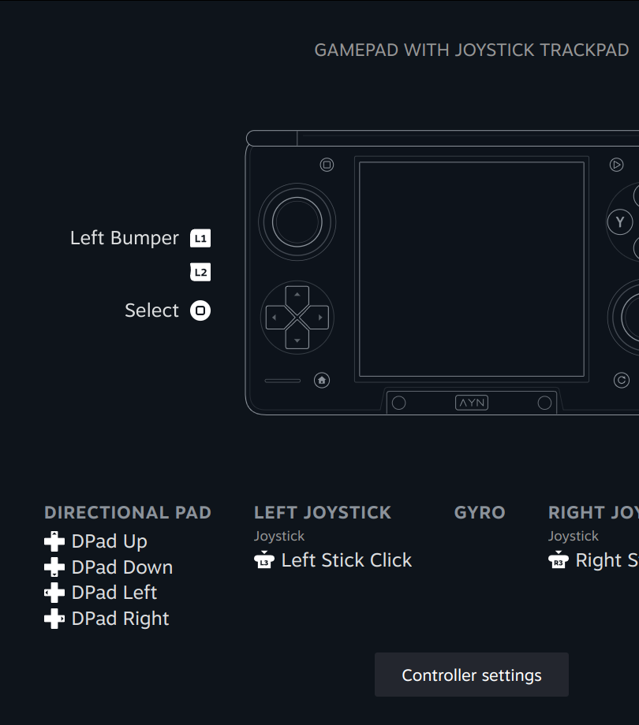

# Drawing the Thor in Steam (ThorLook)

Steam draws the controller in several places: controller settings, Test Device Inputs, the layout editor, the Quick Access controller panel and the game-launch screen. On the Thor it shows a Switch Pro Controller or a Steam Deck there. ThorLook is a Decky plugin that makes Steam draw the Thor instead, in Steam's own style, with the icons printed on the Thor's buttons. Source: [reference/thorlook/](../reference/thorlook/). Art: [art/](../art/).

**Nothing in Steam's files is edited.** Everything is CSS and DOM changes made at runtime from the plugin, so there's nothing in Steam's files to undo or for a Steam update to overwrite.

## How it works

### The controller picture

Steam picks the picture with a CSS rule like `.controller_switch_pro .<hashed> { background-image: url(/images/controller/controller_config_controller_switch_pro.png) }`. The class after `.controller_<type>` is a hashed CSS-module name that changes between Steam builds. So ThorLook doesn't hard-code it. It searches every stylesheet in every Steam window, including ones Steam loads later, for rules whose `background-image` is Steam's controller image, and overrides that same selector with the Thor drawing. Quick Access, the main menu and toasts are separate browser windows, so it watches each of them.

### Button icons

Steam's Game Mode draws button icons as `.svg">`. A CSS rule like `img[src$="/switchpro_button_home.svg"] { content: url(...) }` swaps an icon everywhere it appears. ThorLook swaps:

| Steam's icon | Replaced with | Thor button |
|---|---|---|
| `switchpro_button_home` | a house | Home |
| `switchpro_button_plus` | an outlined triangle | Start |
| `switchpro_button_minus` | a small rounded square | Select |
| `sc_button_steam` (the "Menu" hint in the footer on the handheld identity) | a house | Home |

Steam's own circled A/B/X/Y icons already match the Thor's printing, so they stay. Steam never draws a Quick Access icon (its tour teaches a two-button shortcut instead), so there's nothing to swap there. This is the method of the MIT-licensed [Handheld Controller Glyphs](https://github.com/victor-borges/handheld-controller-glyphs) CSS Loader theme, done in my own plugin.

### Test Device Inputs: a live Thor

On Test Device Inputs, ThorLook hides Steam's drawing and puts the Thor drawing inline in its place, so it can light the Thor's own buttons. It reads Steam's pressed state for A/B/X/Y, Home, Select, Start, L and R, moves the sticks from Steam's joystick rows, and fills the trigger markers in proportion to the analog pull. It also hides the rows for buttons the Thor doesn't have (L4, L5, R4, R5, trackpads).

Two things Steam doesn't give it:

- **The D-pad.** Steam's handheld drawing has no D-pad, so the plugin's backend (a root process, `main.py`) reads the Thor's own pad (`AYN Odin2 Gamepad`, the `BTN_DPAD_*` keys, through the `EVIOCGKEY` ioctl). The screen polls it about 30 times a second while it's open.
- **Which button was Quick Access** on the Switch Pro identity, where Quick Access arrives as a Home + B chord ([switch-pro-identity.md](switch-pro-identity.md)). The backend reports which physical button was pressed last, so the drawing lights the Quick Access button instead of Home and B.

To stop Steam's own picture flashing for a moment first, the swap runs from a `MutationObserver` before the first paint, not on a timer.

### The game-launch screen

While a game starts, Steam shows the controller it will use, as a looping video (`/movies/<type>_*.webm`) or a still, in a box whose CSS-module class is `ControllerInterstitialAnimationContainer`. When the active controller is the Thor, ThorLook hides that and shows the animated Thor inline, restarting its 2.2-second intro every 3 seconds. A plugged-in pad keeps Steam's own picture. The box's class name is read at runtime from Steam's CSS-module export, with `video > source[src^="/movies/"]` as the fallback.

### The name

ThorLook renames the Thor's virtual pad to "AYN Thor" with Steam's own controller-name setting (`SteamClient.Input.SetControllerName`). It only does that while the pad still has Steam's default name, and only for the Thor's virtual pad, which it recognises by its serial. So a real Pro Controller, or a name you picked, is never touched. It also changes "Switch Pro" to "AYN Thor" where Steam mentions the controller type in running text.

## Checked on my Thor

- Every Steam screen that draws the controller (controller settings, Test Device Inputs, the layout editor, the Quick Access controller panel) shows the Thor: a separate review compared screenshots of each.
- It survives a Steam restart.
- The system-button icons in Steam's menus are the printed ones, on both identities: a separate review compared screenshots against the printed-icon list.
- The game-launch screen shows the animated Thor: a separate review of a screenshot taken during a launch.
- Test Device Inputs, tested by hand: "this screen looks great now. All of the buttons work properly. They light properly. The triggers work properly."

## Not done

- **Icons inside games that ask Steam for icon images.** Those games load image files from Steam's `controller_base/images/api/` folder, which runtime CSS can't reach. They still get Steam's standard Switch Pro or handheld icons. Overlaying those files at runtime from the root backend would be the next step. I haven't built it.
- **The Calibration screen.** ThorLook swaps the Steam Controller pictures there (`steamcontroller_left` / `_right`) for crops of the Thor, with the sticks placed on Steam's deadzone circles ([make_calibration.py](../art/tools/make_calibration.py)). I haven't put it through the same screenshot check as the other screens.

## Build it

`python reference/thorlook/build.py` writes `reference/thorlook/decky/dist/index.js` with the drawings embedded as data URIs (no Node build, no files served at runtime). A Decky plugin folder is `dist/index.js` plus `main.py`, `plugin.json` and `package.json`. `plugin.json` asks for root (`"flags": ["root"]`) because the backend reads the pad. Decky loads a new plugin folder as soon as it appears. Updating one that's already installed needs a Decky restart, which reloads Steam's UI.
